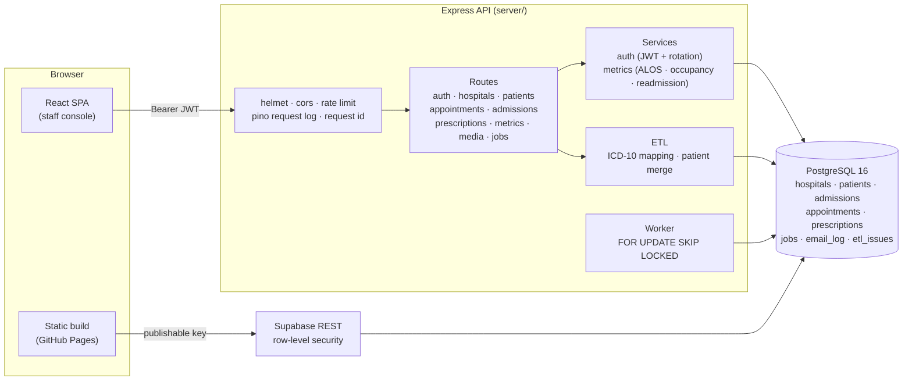

# Jaipur Health TPA — Clinic Appointment & e-Prescription Platform

[](https://github.com/rabinarayanpatra350-biotech/jaipur-health-tpa/actions/workflows/ci.yml)
[](https://rabinarayanpatra350-biotech.github.io/jaipur-health-tpa/)
[](#testing)

A complete clinic platform for a fictional Jaipur health-insurance TPA covering **four hospitals**:
appointments, admissions, e-prescriptions and a claims dashboard reporting **average length of stay,
bed occupancy and 30-day readmission**.

**Stack:** React 18 + Vite · Node 20 + Express · PostgreSQL 16 · JWT with rotating refresh tokens ·
PostgreSQL-backed job queue · GitHub Actions CI · GitHub Pages (live) · Render (API + database).

## Live

### **https://rabinarayanpatra350-biotech.github.io/jaipur-health-tpa/**

A working build reading the same live PostgreSQL database as the full application — browse the four
hospitals, open one for its departments, doctors and metrics, and open the claims dashboard.

GitHub Pages serves files and runs no code, so this build reads the database through Supabase's REST API
and **only from aggregate-only views**. There is no sign-in here, and no patient row, diagnosis or
prescription is reachable from the browser. The complete server-side application — JWT sessions, staff
roles, patient records, the job queue — is in [`server/`](server/) and covered by **97 passing tests**.

## Architecture



## Quick start

```bash
cd server
npm install
npm run db:local      # starts a real PostgreSQL from bundled binaries, prints DATABASE_URL
export DATABASE_URL=postgres://postgres@127.0.0.1:55432/hospital
npm run migrate
npm run seed          # loads the four hospitals' messy exports
npm test              # 97 tests
npm start             # http://localhost:4000/api/health
```

## The data problem

The four hospitals hand over anonymised exports that are messy in exactly the ways the brief names.
Each is handled by a rule, not by hand.

### 1. Diagnosis written in free text instead of codes

`T2DM`, `Type II DM`, `DM2` and `diabetes mellitus type 2` are the same diagnosis; `HTN` and `high bp`
are another. A fuzzy match would confidently map `DM` to both *diabetes* and *dermatomyositis* — on a
claims dataset that is not a rounding error, it is a wrong payment.

So the mapping is an **explicit, reviewable table** (`src/etl/icd10Map.js`, extensible from the TPA's own
`diagnosis_dictionary.csv`). **Both** the derived code and the original free text are stored, so a mapping
can be audited rather than trusted. Text the table does not recognise is **reported, never guessed**:

```
Diagnosis coding coverage : 825/900 visits (91.7%)
Unmapped free-text diagnoses: 75
```

### 2. Missing discharge dates

28 of the exported stays have no discharge date. Three states are distinguishable and must not be
conflated:

| State | Handling |
|---|---|
| discharge present and after admission | a closed stay — used for length of stay |
| discharge absent | an **open stay** — counted in occupancy, excluded from ALOS |
| discharge **before** admission | impossible — quarantined with a reason code, plus a `CHECK` constraint |

The export cannot tell "still in hospital" from "date was lost", so the pipeline does not pretend to. It
records the stay as open and reports how many there are.

### 3. Patients registered twice with different IDs

Two identity keys are built — **name + date of birth**, and **name + phone** — because neither alone is
enough (15% of rows have no DOB, 10% no phone). A row is merged only on an exact match after
normalisation of casing, spacing and phone formatting. **Name alone is never used**: two different Ramesh
Sharmas in Jaipur is not a rare event, and merging them would attach one person's clinical history to
another.

Every merge writes a row to `patient_merges` with the rule and the evidence that justified it, so a merge
can be explained — and reversed — later.

## Metrics

Defined once, in `src/services/metricsService.js`, so the dashboard, the tests and the report cannot drift
apart:

- **Average length of stay** = total bed-days of closed stays ÷ discharges. Open stays are excluded —
  dividing by an invented discharge date would understate the average.
- **Bed occupancy** = occupied bed-days ÷ (licensed beds × nights). One row per admission per night *is* a
  bed-day; grouping by (hospital, date) instead would cap occupancy at hospitals × days.
- **30-day readmission** = discharges with a later admission within 30 days ÷ discharges — **at any
  hospital in the group**, because a patient discharged from SMS and readmitted at Fortis is still a
  readmission. That is the whole point of a TPA looking across four providers.

Current figures on the seeded dataset: **ALOS 6.06 days · occupancy ~48% · readmission ~9%**.

## API

Full reference: [`docs/openapi.yaml`](docs/openapi.yaml). Conventions: every success is `{ data }`, every
error is `{ error: { code, message, details? } }`.

| Method | Path | Access |
|---|---|---|
| POST | `/api/auth/signup` · `/login` · `/refresh` · `/logout` | public |
| GET | `/api/auth/me` | any signed-in |
| GET/POST/PATCH | `/api/auth/users` | admin |
| GET | `/api/hospitals` · `/api/hospitals/:id` | public |
| PATCH | `/api/hospitals/:id` | admin |
| GET/POST/PATCH | `/api/patients` | clinician, admin |
| GET/POST/PATCH | `/api/appointments` | clinician, admin |
| GET/POST/PATCH | `/api/admissions` | clinician, admin |
| GET/POST | `/api/prescriptions` | clinician, admin (patient: own only) |
| GET | `/api/metrics` · `/api/metrics/:id/occupancy` | clinician, admin |
| POST/GET | `/api/media` | clinician, admin |
| GET | `/api/jobs` · `/api/jobs/emails` | admin |

## The stretch requirement

**Email notifications and a background job queue.**

Sending an email is a network call to somebody else's server. Done inline, a slow SMTP host becomes a slow
appointment booking and an SMTP outage becomes a failed booking — for a booking already committed. So the
job is enqueued **in the same transaction as the business event**: either both exist or neither.

The queue is **PostgreSQL, not Redis**. Workers claim rows with `FOR UPDATE SKIP LOCKED`, so two workers
cannot claim the same row and a worker that dies leaves its lock to be reclaimed. It retries with
**exponential backoff and jitter**, deduplicates on a key, gives up after `max_attempts`, and is
observable at `/api/jobs`.

Three notifications are queued — appointment confirmation, clinic alert, prescription issued — and every
attempt is written to `email_log`, so "we told this patient" is a queryable fact.

Templates deliberately carry **no clinical content**: a notification that says *"you have an appointment"*
is safe over unencrypted mail; one that says *"your test result is ready"* is not.

## Testing

```
✓ tests/unit/normalise.test.js   (30)   dates, phones, genders, patient keys, row validators
✓ tests/unit/icd10.test.js       (20)   free-text → ICD-10, overrides, refusals
✓ tests/api/auth.test.js         (12)   signup, login, rotation, reuse detection, logout
✓ tests/api/rbac.test.js          (7)   patient < clinician < admin, enforced in the API
✓ tests/api/metrics.test.js       (7)   ALOS, occupancy, readmission vs hand-computed figures
✓ tests/api/resources.test.js    (21)   CRUD, filters, validation, job enqueueing
                                   97 passing
```

The metrics tests build a ten-bed hospital with a known set of stays and assert against numbers worked
out by hand, so a change in definition fails the build rather than the monthly report.

## Deployment

- **GitHub Pages** — `docs/index.html`, published from `main`. Live now.
- **Render** — `render.yaml` creates the API, a worker and a managed PostgreSQL together.
- **Vercel** — `web/vercel.json` for the React build.

No secret is committed; the CI `secrets` job fails the build if one is.

## The weakest part of the design

**The patient-identity resolution.** Name + DOB and name + phone catch the duplicates in this dataset, but
they will not catch a patient registered as `R. Sharma` at one hospital and `Ramesh Kumar Sharma` at
another, or a phone number shared by a family. Worse, the merge is **not reversible in the database**: the
merged MRN points at the survivor, but nothing re-splits it if the match was wrong.

The fix is a real master-patient index: deterministic matching on (name, DOB, phone) as a first pass, then
probabilistic scoring with a human review queue for the middle band, and a merge that can be undone by
replaying `patient_merges` backwards. The evidence is already recorded for exactly that reason.

